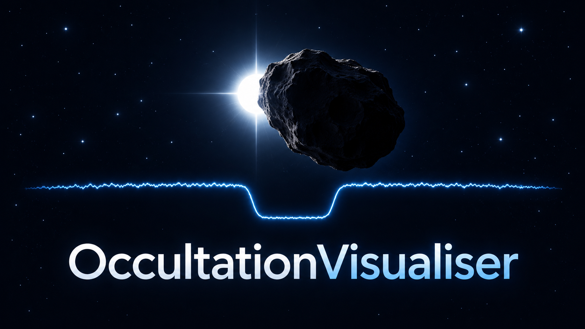

# OccultationVisualiser

**English** | [简体中文](README.zh-CN.md)



The launch cover closes after 1.2 seconds or a click/Escape; reopen it with **Cover / About**. The coordinated icon appears in native application packages. This is conceptual brand artwork, not a measured light curve. [Artwork generation prompts](src/occultation_media/assets/branding/prompts.json) are included; release archives also contain the `branding` folder.

Turn an occultation observation into a synchronized star-field and light-curve animation (GIF, MP4 and PNG preview). An occultation is a star temporarily hidden by an intervening object. This tool visualises **existing photometry**; it does not extract a light curve from a video or run PyOTE fitting. No Tangra, PyMovie or PyOTE installation is needed to render already exported inputs.

Previously **OccultationMedia**. New builds use `OccultationVisualiser.app` / `OccultationVisualiser.exe` and the `occultationvisualiser` command. The Python import `occultation_media` and old `occultation-media` commands remain compatible. The GitHub repository is now OccultationVisualiser; existing local checkouts may retain the old folder name.

## GUI quick start (v1.9)

Use the prominent **中文 / English** picker at the top right for the interface. Export language is independent; switching the interface retains every input and running job.

1. Enter asteroid, target star and the UTC date, then choose an output folder. Fields marked * are required.
2. Add a station and choose its CSV/LC curve plus the original images for an animation. The editor detects the curve format, suggests its target column and reads recorded exposure. PyOTE result JSON is optional.
3. **Full recording coverage** is the default; it needs neither typed start/end times nor D/R. **D/R event windows** use supplied/saved disappearance and reappearance with configurable padding. **Custom start/end UTC** crops the displayed video, e.g. 09:54:20 to 09:54:45; use a full date across midnight. It does not set source frame numbering or change measured D/R.
4. Location and prediction have an optional tab. Leave coordinates blank for one or several stations. North-to-south order sorts known locations and appends unknown ones; it does not invent positions.
5. Choose skip/keep gaps and real event speed or a fixed video duration. Skipping gaps retains the absolute UTC clock and explicit axis breaks; fixed duration changes playback only.
6. **Verify timestamps** audits original frame times. **Generate** exports GIF, MP4 and PNG. **Noise diagnostics** creates curve-only JSON/CSV reports and a selectable shared-UTC station-pair plot; D/R is needed to identify a baseline, but missing D/R simply leaves that statistic unavailable.
7. Save/Open retains the project. View diagnostics reopens a `quality_report.json`. Each run saves resolved settings, input hashes and executing-code provenance.

| Input | When needed |
| --- | --- |
| Image source | Animation/verification; optional for curve-only diagnostics |
| Coordinates, altitude, prediction | Optional labels/order; unrelated to UTC verification |
| PyOTE results or both supplied D/R | D/R crops and identified baseline statistics; optional for full recording media |
| Exposure | Automatically read from FITS/ADV/RAVF/LC, PyMovie shutter headers or CameraSettings; Advanced override only if absent or explicitly needed |
| Frame-ID offset | Optional Advanced override for cropped recordings; default matches source UTC |
| Tracking CSV | Optional if an imported normalized curve lacks original target positions |

**Exposure and cadence are different.** SER UTC trailers record cadence, not exposure; the app reads capture settings instead. Historical projects retain their explicit exposure and frame overrides, visibly identified in the editor. Missing exposure records produce a clear message; they are not replaced by cadence.

**Curve type** describes imported data. `raw` is original target counts. In our reduction workflow, `C3/C4` identify the reference star used for an already-exported normalized curve, not different fitting algorithms. Auto reads the result's mode, otherwise uses raw. Select the matching analysis CSV and result for C3/C4; no normalization or fitting happens in this app.

Station headers show saved per-exposure baseline SNR (`B / sigmaB`), or direct whole-exposure baseline statistics when native parameters are absent. Diagnostics displays saved SNR separately from a guarded baseline (default: exclude D−1 s through R+1 s, independent of video padding). Comparisons retain shared absolute UTC and exclude both events; recordings without overlap are unavailable. Linear residual and adjacent-difference scatter are separate diagnostics, not replacement curves/SNR. The PyMovie spatial-background budget `sigma_pixel*sqrt(N_mask)` assumes independent representative pixels; it does not isolate read noise and omits source shot noise/background-estimator uncertainty. Raw-pixel budgets are disabled for C3/C4. See [definitions and configuration](docs/native_station_media.md).

CLI: `occultationvisualiser --media-config project.json --quality-only`. Optional `diagnostic_margin_s` changes the baseline guard. Curve-only diagnostics does not verify source-image timestamps; use Verify for that audit.

### Timestamp policy

For current SharpCap recordings, SER and FITS `DATE-OBS` mean exposure start and receive half an exposure for midpoint display. `DATE-AVG` and ADV are midpoint; RAVF uses its native start. PyMovie follows the image-source convention; Tangra CSV is interpreted as exported midpoint UTC. Saved PyOTE D/R is never shifted again.

The policy appears in the GUI and saved configuration. Source and curve UTC must still agree. Older SharpCap versions, externally retimed data or already-converted CSVs may differ: investigate mismatches rather than arbitrarily enlarging tolerance. [SharpCap author's explanation](https://forums.sharpcap.co.uk/viewtopic.php?t=9540).

### Input checklist

| Workflow | Files |
| --- | --- |
| Tangra full field | Photometry CSV (object 1) or timed LC curve + ADV2/SER/RAVF/timed FITS sequence |
| Tangra cutout | CSV or LC curve + matching LC image source; only the 35×35 recorded target stamp |
| PyMovie | CSV + original image source; optional original tracking CSV |
| PyOTE interval | Add compatible result JSON, or enter both D/R UTC in Advanced |

AVI/MP4 are not supported inputs. Screenshots, reports and CSV alone cannot provide recorded images. Strict timing mode does not accept FITS cubes without individual frame times.

## 2. Start the application

Existing packages are listed under [Releases](https://github.com/hjs12345678900/OccultationVisualiser/releases). Older releases retain the old application name; this source rename does not update an already downloaded package.

- **Windows 10/11 x64:** extract the whole ZIP and open `OccultationVisualiser.exe`. Keep `_internal` beside it.
- **macOS 14+:** extract and open `OccultationVisualiser.app`. The configured build targets Intel; Apple Silicon needs Rosetta. Packages are unsigned/unnotarized.

To run this checkout, use Python 3.13 with Tk support. Open a terminal **in the project folder**, then:

```bash
python3 -m venv .venv
source .venv/bin/activate
python -m pip install -e .
python launch.py
```

On Windows use `py -3.13 -m venv .venv`, then `.venv\Scripts\activate` instead of the first two commands. `python -m tkinter` checks whether Tk is available. The installation includes the FFmpeg dependency and bundled fonts. Keep observation files in your own event folder; no copying into this repository is required.

### What counts as a supported PyOTE result?

`native_results.json` is the saved native-result schema used by our reduction workflow, **not an arbitrary PyOTE report, XLSX, log or screenshot**. The filename itself is not significant. Required JSON fields are `timesAreValid: true`, `Dframe`, `Rframe`, `Dtime`, `Rtime`; `mode` defaults to `raw` and must match `native_mode`. D/R mean disappearance/reappearance. Times are numeric seconds from UTC midnight; frames refer to the same curve. Optional `xlsxDict.Derr95/Rerr95` are retained as provenance. Both boundaries must fall within the curve and agree with their frame times. Do not fabricate a JSON from guessed values.

For independently reported boundaries, omit `pyote_result` and supply both `D_utc` and `R_utc` as full UTC ISO timestamps; optionally supply `timing_source_file`. Saved D/R is displayed without re-fitting or applying another half-exposure correction. D-only/R-only fits are not supported by this overlay.

For saved C3/C4 products, point `curve` to `native_analysis.csv`, set the corresponding `native_mode`, and supply that mode's result JSON. Use the original `pymovie_native.csv` as `tracking_csv` if the analysis CSV lacks centroids. Tracking columns are `xcentroid-<target>`, `ycentroid-<target>` and optional `hit-defect-<target>`. Tracking and analysis frame/UTC identities must match exactly. No normalization or detrending is performed here.

See [the full configuration and UTC contract](docs/native_station_media.md) for Tangra JSON inputs, acquisition corrections, byte order, partial FITS coverage and all fields.

## 5. Find and check the results

Each run gets a new output directory. Expect GIF, PNG preview and MP4 (unless disabled in the Tangra form), separately for requested languages. Configuration runs also save contact sheets, resolved configuration, source snapshot, input hashes and timestamp evidence in `media_metadata.json` / `run_metadata.json`. `--verify-only` writes audit products, not animations. Desktop jobs retain `run.log` and `result.json`; configuration media is inside their `media` subfolder.

| Problem | What to check |
| --- | --- |
| File not found | Replace all template paths; check paths relative to the JSON location |
| Missing column/header | Use the original supported CSV export, not a reformatted spreadsheet; check exact target name |
| UTC/frame mismatch | First-sample date, exposure units, start/mid/end convention, source frame ID and known camera delay |
| SER/FITS lacks UTC | Supply the original timed source; strict mode cannot invent timestamps |
| Saved times invalid / wrong mode | Supply the matching saved fit or omit `pyote_result` |
| Blank station image | Recording may not cover the selected UTC; inspect timestamp audit |
| Target marker wrong | Correct X Y in the Tangra form, or provide matching native tracking columns |
| Generation failed | Read `run.log` and failed run metadata before retrying |

These products visualise recorded data; clock agreement does not independently establish clock accuracy or a formal timing measurement.

## Development and builds

```bash
python -m unittest discover -s tests -v
python launch.py --self-test
python -m pip install -e ".[build]"
```

Run `Build-Windows.bat` or `Build-Mac.command` to test and build. Packaging alone: `python package_windows_only.py` on Windows, or `python -m PyInstaller --noconfirm --clean OccultationVisualiser.spec` on Mac. Release archives include this guide, its Chinese translation and editable JSON templates beside the application. GitHub Actions supports manual builds and release tags. See [THIRD_PARTY.md](THIRD_PARTY.md) for licenses.
